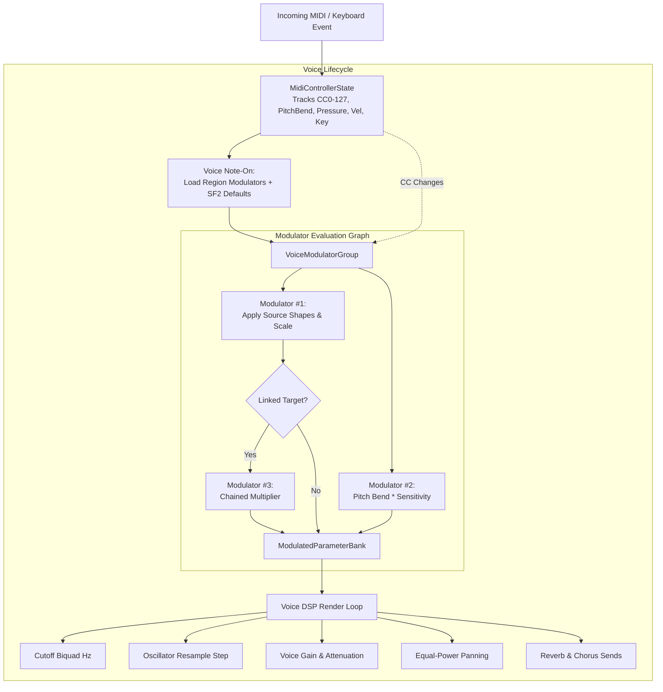
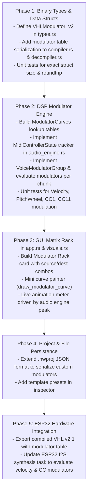

# SOUNDFONT 2 & POLYPHONE MODULATOR ARCHITECTURE
## Complete Deep-Dive Study & Implementation Plan for HarmoniumWorkstation

---

## TABLE OF CONTENTS
1. [Executive Summary & Core Concept](#1-executive-summary--core-concept)
2. [Dedicated Study: What Are Modulators? (Why They Are NOT Modulation Envelopes)](#2-dedicated-study-what-are-modulators)
3. [Deep-Dive Analysis of Polyphone SoundFont Engine](#3-deep-dive-analysis-of-polyphone-soundfont-engine)
   - 3.1 Data Structures: `SFModulator` & `ModulatorData`
   - 3.2 Shaping Curves: Linear, Concave, Convex, Switch (Math & Lookup Tables)
   - 3.3 Direction, Polarity, and Secondary Scaling
   - 3.4 The 10 SF2 Mandatory Default Modulators
   - 3.5 Runtime Execution Flow: `ParameterModulator`, `ModulatedParameter`, `ModulatorGroup`
   - 3.6 Modulator Linking & Graph Resolution
4. [Comprehensive System Architecture for HarmoniumWorkstation](#4-comprehensive-system-architecture-for-harmoniumworkstation)
   - 4.1 Binary File Format Specification (`VHLModulator_v2`)
   - 4.2 Real-time DSP Engine (`audio_engine.rs`)
   - 4.3 MIDI Controller State Tracker (`MidiState`)
   - 4.4 Modulator Routing Matrix & Dependency Graph
   - 4.5 Target Parameter Mapping (Generators)
5. [User Interface & Visual Design Architecture](#5-user-interface--visual-design-architecture)
   - 5.1 Modulator Matrix Rack UI
   - 5.2 Real-time Curve Visualizer & Animation
   - 5.3 Inspector Integration & Preset/Default Modulator Templates
6. [Step-by-Step Implementation Roadmap](#6-step-by-step-implementation-roadmap)
7. [Mathematical & Code Reference (Rust Ready)](#7-mathematical--code-reference-rust-ready)

---

## 1. Executive Summary & Core Concept

In standard SoundFont 2 (SF2 v2.04) and high-end digital synthesizers, a sound is defined not only by static parameters (sample pitch, root key, filter cutoff) and autonomous time-based generators (envelopes and LFOs), but fundamentally by **dynamic response to human expression**.

A **Modulator** is a generalized dynamic mathematical patch cable connecting an **Input Controller** (such as Note-On Velocity, Mod Wheel CC1, Expression CC11, Pitch Bend, Aftertouch, or another modulator) through a **Shaping Function** (Linear, Concave, Convex, Switch), scaled by an optional **Secondary Controller** and a calibrated **Amount**, to a **Destination Synthesis Generator** (Filter Cutoff, Pitch, Volume Attenuation, Pan, Reverb/Chorus Send, Envelope Times, or LFO Depths).

This document provides:
1. An exhaustive theoretical and mathematical explanation of SoundFont 2 modulators.
2. A reverse-engineered analysis of Polyphone's implementation (`sources/core/types/modulatordata.cpp`, `sources/sound_engine/parametermodulator.cpp`, `modulatorgroup.cpp`).
3. A complete, production-grade architectural blueprint for integrating a full modulator engine into `HarmoniumWorkstation` (DSP engine, binary `.vhl` compiler/decompiler, `.hwproj` projects, and GUI).

---

## 2. Dedicated Study: What Are Modulators?

> [!IMPORTANT]
> **Modulators vs. Modulation Envelopes: The Fundamental Distinction**
> - A **Modulation Envelope** is an **autonomous, time-triggered trajectory generator** (DAHDSR: Delay, Attack, Hold, Decay, Sustain, Release). Once a note is struck, it advances through predefined time intervals regardless of ongoing player actions.
> - A **Modulation LFO** is an **autonomous cyclical oscillator** (Sine/Triangle wave at e.g. 5 Hz).
> - A **Modulator** is **NEITHER of these**. A Modulator is an **open-ended routing matrix and transfer function engine**. It evaluates physical player performance data (MIDI controllers, key velocity, aftertouch, expression pedals) and dynamically drives synthesis generators in real time.

```mermaid
flowchart LR
    subgraph Autonomous Generators
        ENV["Modulation Envelope\n(Time DAHDSR)"]
        LFO["Modulation / Vib LFO\n(Cyclical Sine Osc)"]
    end

    subgraph Physical Player Gestures
        VEL["Note-On Velocity"]
        KEY["MIDI Key Number"]
        BEND["Pitch Bend Wheel"]
        CC1["CC1 Mod Wheel"]
        CC11["CC11 Expression"]
        PRESS["Channel / Poly Pressure"]
    end

    subgraph Modulator Matrix (Dynamic Routing)
        MOD1["Modulator #1:\nVelocity -> Cutoff"]
        MOD2["Modulator #2:\nCC1 x PitchSensitivity -> Pitch"]
        MOD3["Modulator #3:\nCC11 -> Attenuation"]
        MOD4["Modulator #4:\nAftertouch -> Vib LFO Depth"]
    end

    subgraph Voice DSP Synthesizer
        FC["Filter Cutoff (Hz)"]
        PITCH["Voice Pitch (Cents)"]
        GAIN["Attenuation (dB)"]
        VIB["Vibrato Depth"]
        SENDS["Reverb / Chorus Sends"]
    end

    VEL --> MOD1 --> FC
    BEND --> MOD2 --> PITCH
    CC11 --> MOD3 --> GAIN
    PRESS --> MOD4 --> VIB
```

### Why Modulators Are Essential for Expressive Instruments
Without modulators:
- Striking a harmonium key softly or with maximum force sounds identical, only quieter if fixed velocity attenuation is used.
- Pitch bend wheels do nothing.
- Expression pedals (CC11) or volume pedals (CC7) do not affect timbre or loudness.
- Moving the modulation wheel (CC1) cannot introduce vibrato or tremolo.
- Pressing down on keys after striking (Aftertouch / Polyphonic Pressure) cannot open up acoustic reed harmonics.

With modulators:
- **Velocity-Responsive Acoustics**: Hitting a key harder increases brightness (Filter Cutoff increases by $+2400\text{ cents}$) and shortens attack time (emulating high bellows pressure).
- **Acoustic Pressure Dynamics**: Real-time expression controllers smoothly cross-modulate reed resonance, volume, and chorus.
- **Microtonal Bending**: The pitch bend wheel is multiplied by pitch bend sensitivity to deliver exact microtonal shruti inflections.

---

## 3. Deep-Dive Analysis of Polyphone SoundFont Engine

Polyphone implements the full SoundFont 2.04 modulator specification across three core layers:
1. `sources/core/types/modulatordata.h / .cpp`: Data structures, serialization, and mathematical shaping tables.
2. `sources/sound_engine/parametermodulator.h / .cpp`: Individual runtime evaluator for a single modulator.
3. `sources/sound_engine/modulatorgroup.h / .cpp`: Container managing voice modulators, default modulator inheritance, and topological execution order.

### 3.1 Data Structures: `SFModulator` & `ModulatorData`

In Polyphone, a modulator source definition is packed into a 16-bit word (`SFModulator`):

```cpp
class SFModulator {
    quint8 Type : 6;          // ModType: 0=Linear, 1=Concave, 2=Convex, 3=Switch
    bool isBipolar : 1;       // Polarity: false=Unipolar [0, 1], true=Bipolar [-1, +1]
    bool isDescending : 1;    // Direction: false=Ascending (0 -> 1), true=Descending (1 -> 0)
    bool CC : 1;              // Controller Flag: false=General Controller, true=MIDI CC (0-127)
    quint8 Index : 7;         // Controller Index (GeneralController enum or CC number)
};
```

#### General Controller Enums (`GeneralController`)
When `CC == false`, the 7-bit `Index` corresponds to:
- `0`: `GC_noController` (Acts as constant $1.0$; used when no secondary source is active)
- `2`: `GC_noteOnVelocity` (MIDI key velocity $0\dots127$)
- `3`: `GC_noteOnKeyNumber` (MIDI pitch $0\dots127$)
- `10`: `GC_polypressure` (Individual key aftertouch pressure)
- `13`: `GC_channelPressure` (Global keyboard mono aftertouch)
- `14`: `GC_pitchWheel` (Pitch bend $-8192\dots+8191$, normalized to $0\dots127$ with center at $64$)
- `16`: `GC_pitchWheelSensitivity` (Pitch wheel range in semitones)
- `127`: `GC_link` (Output of another modulator linked as input)

#### The Master Modulator Record (`ModulatorData`)
Each modulator is represented by:
```cpp
class ModulatorData {
    SFModulator srcOper;      // Primary source controller + curve + polarity + direction
    quint16     destOper;     // Destination generator index (or target modulator index if >= 32768)
    SFModulator amtSrcOper;   // Secondary source controller (scales the amount)
    SFTransform transOper;    // 0 = linear, 2 = absolute_value
    qint16      amount;       // Signed 16-bit modulation depth in destination units
    quint16     index;        // Identifier for cross-modulator links
};
```

---

### 3.2 Shaping Curves: Math & Lookup Tables

The SoundFont 2 spec and Polyphone define four distinct transfer curves (`ModType`):

```
Type 0: Linear                Type 1: Concave               Type 2: Convex               Type 3: Switch
1.0 ┌──────────────/          1.0 ┌────────────────/        1.0 ┌────────/───────        1.0 ┌───────────|────
    │             /               │               /             │       /                     │           |
    │            /                │             /               │      /                      │           |
    │           /                 │           /                 │     /                       │           |
    │          /                  │         /                   │    /                        │           |
0.0 └─────────/─────          0.0 └────────/────────        0.0 └───/────────────        0.0 └───────────|────
    0            127              0              127            0             127            0    63  64   127
```

#### Mathematical Formulas
In `modulatordata.cpp`, Polyphone precalculates lookup tables for indices $0\dots127$:
For input index $i \in [1, 126]$:
$$x = -\frac{20.0}{96.0} \cdot \frac{\ln\left(\frac{i^2}{127.0^2}\right)}{\ln(10.0)}$$
$$\text{convexTable}[i] = 1.0 - x$$
$$\text{concaveTable}[127 - i] = x$$
Boundaries:
$$\text{convexTable}[0] = 0.0, \quad \text{convexTable}[127] = 1.0$$
$$\text{concaveTable}[0] = 0.0, \quad \text{concaveTable}[127] = 1.0$$

- **Concave**: Maps acoustic attenuation in decibels over a 96 dB dynamic range. As input increases from 0, the output rises slowly at first, then accelerates upwards towards 1.0.
- **Convex**: The inverse of concave. It rises sharply from 0 and levels off towards 1.0.
- **Switch**: Produces $0.0$ for input $< 64$ and $1.0$ for input $\ge 64$.
- **Linear**: Direct division $v / 128.0$.

---

### 3.3 Direction, Polarity, and Secondary Scaling

The complete transfer function for an input value $v \in [0, 127]$ is:

1. **Base Value Shaping**:
   $$f(v) = \begin{cases}
   v / 128.0 & \text{if Linear} \\
   \text{concave}(v) & \text{if Concave} \\
   \text{convex}(v) & \text{if Convex} \\
   (v \ge 64 \,?\, 1.0 : 0.0) & \text{if Switch}
   \end{cases}$$

2. **Direction (Descending vs. Ascending)**:
   If `isDescending == true`:
   $$f_{\text{dir}}(v) = 1.0 - f(v)$$

3. **Polarity (Bipolar vs. Unipolar)**:
   If `isBipolar == true`:
   $$f_{\text{final}}(v) = 2.0 \cdot f_{\text{dir}}(v) - 1.0 \quad \in [-1.0, +1.0]$$
   Else:
   $$f_{\text{final}}(v) = f_{\text{dir}}(v) \quad \in [0.0, 1.0]$$

4. **Multiplication with Secondary Source**:
   Let $S_1 = f_{\text{final, src}}(v_1)$ and $S_2 = f_{\text{final, amtSrc}}(v_2)$.
   $$\text{Result}_{\text{raw}} = S_1 \cdot S_2 \cdot \text{Amount}$$

5. **Transform Operator**:
   $$\text{ModulationOutput} = \begin{cases}
   \text{Result}_{\text{raw}} & \text{if } \text{transOper} == \text{linear} \\
   |\text{Result}_{\text{raw}}| & \text{if } \text{transOper} == \text{absolute\_value}
   \end{cases}$$

---

### 3.4 The 10 SF2 Mandatory Default Modulators

In SoundFont 2.04, if a sound designer defines no modulators at all, the engine MUST instantiate these 10 default modulators (`ModulatorData::s_defaultMods[10]` in Polyphone):

| # | Primary Source | Type | Dir | Pol | Secondary Source | Amount | Destination | Musical Meaning |
|---|----------------|------|-----|-----|------------------|--------|-------------|-----------------|
| **1** | Velocity | Concave | Desc | Uni | None | $+960\text{ cb}$ | `initialAttenuation` | Harder hits are louder (up to $96\text{ dB}$ attenuation on softest hits) |
| **2** | Velocity | Linear | Desc | Uni | None | $-2400\text{ c}$ | `initialFilterFc` | Softer velocity lowers filter cutoff by up to 2 octaves |
| **3** | Channel Pressure | Linear | Asc | Uni | None | $+50\text{ c}$ | `vibLfoToPitch` | Keyboard aftertouch introduces vibrato pitch wobble |
| **4** | CC1 (Mod Wheel) | Linear | Asc | Uni | None | $+50\text{ c}$ | `vibLfoToPitch` | Mod wheel introduces up to 50 cents vibrato |
| **5** | CC7 (Volume) | Concave | Desc | Uni | None | $+960\text{ cb}$ | `initialAttenuation` | CC7 controls channel volume on 96 dB concave curve |
| **6** | CC10 (Pan) | Linear | Asc | Bi | None | $+1000$ | `pan` | CC10 pans audio across full stereo width |
| **7** | CC11 (Expression) | Concave | Desc | Uni | None | $+960\text{ cb}$ | `initialAttenuation` | Expression pedal dynamically controls volume |
| **8** | CC91 (Reverb) | Linear | Asc | Uni | None | $+200$ | `reverbEffectsSend` | CC91 adds up to 20% reverb send |
| **9** | CC93 (Chorus) | Linear | Asc | Uni | None | $+200$ | `chorusEffectsSend` | CC93 adds up to 20% chorus send |
| **10** | Pitch Wheel | Linear | Asc | Bi | Pitch Wheel Sensitivity | $+12700\text{ c}$ | `fineTune` / Pitch | Bending wheel pitches voice scaled by semitone range |

> [!NOTE]
> If a region or instrument defines a custom modulator with the same Source 1, Source 2, and Destination as a default modulator, the custom modulator **overwrites and replaces** the default modulator!

---

### 3.5 Runtime Execution Flow: `ParameterModulator` & `ModulatorGroup`

In Polyphone, when a note is struck or a MIDI CC arrives:

1. **Voice Creation**:
   - `Voice::initialize` calls `VoiceParam::initialize`.
   - `ModulatorGroup` loads the 10 default modulators, then merges the instrument and preset modulators.
   - For each modulator, `initializeInputs()` grabs current values:
     - Velocity and Key are fixed at note-on.
     - CCs, Pitch Bend, and Pressure are fetched from `IMidiValues`.
2. **Evaluation Cycle**:
   - `ModulatorGroup::process()` initializes all modulators (`_inputCount = 0`).
   - Loop resolves all unlinked modulators first, then passes their outputs to any linked modulators.
   - Outputs are summed into `ModulatedParameter::_instModulation` and `_prstModulation`.
3. **Application to DSP**:
   - When the voice renders audio chunks, it reads:
     - `voiceParam->getFloat(champ_initialAttenuation)` $\to$ sums base attenuation + modulator dB.
     - `voiceParam->getFloat(champ_initialFilterFc)` $\to$ base cutoff $\times 2^{\Delta\text{cents}/1200}$.
     - `voiceParam->getInteger(champ_fineTune)` $\to$ base tuning + pitch bend modulator cents.

---

## 4. Comprehensive System Architecture for HarmoniumWorkstation

To implement modulators completely in `HarmoniumWorkstation`, we need additions across three layers:
1. **Binary Storage (`src/vhl/types.rs`, `compiler.rs`, `decompiler.rs`)**: VHL v2.1 modulator records.
2. **DSP Synthesis Engine (`src/audio_engine.rs`)**: Real-time evaluator and parameter accumulator.
3. **GUI & Inspector (`src/app.rs`, `src/visuals.rs`, `src/widgets.rs`)**: Visual modulator editor with real-time feedback.

---

### 4.1 Binary File Format Specification (`VHLModulator_v2`)

To keep files compact, high-speed, and cache-friendly, each modulator record is fixed at **12 bytes**:

```rust
// ─────────────────────────────────────────────────────────────────────────────
// VHL v2.1 Modulator Binary Definition (12 Bytes Packed)
// ─────────────────────────────────────────────────────────────────────────────

#[repr(C, packed)]
#[derive(Debug, Clone, Copy, PartialEq)]
pub struct VHLModulator_v2 {
    pub src_oper: u16,      // Bitfields: [15:10]=Type, [9]=Bipolar, [8]=Descending, [7]=CC, [6:0]=Index
    pub dest_oper: u16,     // Target generator enum (0..58) or linked modulator index (32768+)
    pub amt_src_oper: u16,  // Secondary controller bitfields (0 = GC_noController)
    pub amount: i16,        // Modulation amount (-32768 .. +32767)
    pub transform: u8,      // 0 = linear, 2 = absolute_value
    pub flags: u8,          // Bit 0 = enabled, Bit 1 = preset_level, Bit 2 = inverted
    pub index: u16,         // Unique modulator ID within this region/instrument
}
```

#### Section Layout in `.vhl`:
The VHL v2.1 file format adds Section 7: **MODULATOR TABLE**:
- Header offset: `offset_modulator_table: u32`
- Total modulators: `total_modulator_count: u16`
- Each Region in `VHLRegion_v2` stores `modulator_offset: u16` and `modulator_count: u16` (or global instrument modulators store their offset in `VHLInstrumentEntry_v2`).

---

### 4.2 Real-Time DSP Engine Architecture (`audio_engine.rs`)



#### Rust Implementation of Shaping Curves (`src/audio_engine.rs`)

```rust
pub struct ModulatorCurves {
    concave: [f32; 128],
    convex: [f32; 128],
}

impl ModulatorCurves {
    pub fn new() -> Self {
        let mut concave = [0.0; 128];
        let mut convex = [0.0; 128];
        concave[0] = 0.0;
        concave[127] = 1.0;
        convex[0] = 0.0;
        convex[127] = 1.0;

        for i in 1..127 {
            let fi = i as f64;
            let x = -20.0 / 96.0 * ((fi * fi) / (127.0 * 127.0)).ln() / 10.0_f64.ln();
            convex[i] = (1.0 - x).clamp(0.0, 1.0) as f32;
            concave[127 - i] = x.clamp(0.0, 1.0) as f32;
        }

        Self { concave, convex }
    }

    #[inline(always)]
    pub fn evaluate(&self, mod_type: u8, is_bipolar: bool, is_descending: bool, val: f32) -> f32 {
        let idx = (val.clamp(0.0, 127.0).round() as usize).min(127);
        let mut shaped = match mod_type {
            0 => val / 128.0, // Linear
            1 => self.concave[idx],
            2 => self.convex[idx],
            3 => if val >= 64.0 { 1.0 } else { 0.0 }, // Switch
            _ => val / 128.0,
        };

        if is_descending {
            shaped = 1.0 - shaped;
        }

        if is_bipolar {
            shaped = 2.0 * shaped - 1.0;
        }

        shaped
    }
}
```

---

### 4.3 MIDI Controller State Tracker (`MidiControllerState`)

Each active MIDI channel tracks all 128 Continuous Controllers, pitch wheel, aftertouch, and channel pressure:

```rust
pub struct MidiControllerState {
    pub cc: [u8; 128],
    pub pitch_wheel: i16,      // -8192 .. +8191 (0 = centered)
    pub pitch_sensitivity: u8,  // Semitones (default = 2)
    pub channel_pressure: u8,  // 0 .. 127
    pub poly_pressure: [u8; 128],
}
```

---

### 4.4 Target Parameter Mapping (Destination Generators)

The complete list of supported destination targets matching SoundFont 2 and Polyphone:

| ID | Generator Target | Unit | DSP Effect in `audio_engine.rs` |
|---|---|---|---|
| `8` | `InitialFilterFc` | Cents | Adjusts low-pass biquad cutoff: $f_c = f_{c,\text{base}} \cdot 2^{\frac{\Delta\text{cents}}{1200}}$ |
| `9` | `InitialFilterQ` | Centibels | Adjusts filter resonance: $Q = Q_{\text{base}} \cdot 10^{\frac{\Delta\text{dB}}{20}}$ |
| `48`| `InitialAttenuation` | Centibels | Adjusts voice volume: $\text{gain} = \text{gain}_{\text{base}} \cdot 10^{-\frac{\Delta\text{dB}}{20}}$ |
| `17`| `Pan` | 0.1% | Offsets equal-power pan position: $\text{pan} = \text{pan}_{\text{base}} + \frac{\text{amount}}{1000}$ |
| `15`| `ReverbEffectsSend` | 0.1% | Adds to reverb send buffer coefficient |
| `16`| `ChorusEffectsSend` | 0.1% | Adds to chorus send buffer coefficient |
| `52`| `FineTune` | Cents | Adjusts voice resample step: $\text{step} = \text{step}_{\text{base}} \cdot 2^{\frac{\Delta\text{cents}}{1200}}$ |
| `51`| `CoarseTune` | Semitones | Adjusts pitch in semitone intervals |
| `5` | `ModLfoToPitch` | Cents | Scales modulation LFO depth to voice pitch |
| `6` | `VibLfoToPitch` | Cents | Scales vibrato LFO depth to voice pitch |
| `7` | `ModLfoToFilterFc` | Cents | Scales modulation LFO depth to filter cutoff |
| `10`| `ModLfoToVolume` | Centibels | Scales modulation LFO depth to voice tremolo |
| `11`| `ModEnvToPitch` | Cents | Scales modulation envelope pitch sweep |
| `12`| `ModEnvToFilterFc` | Cents | Scales modulation envelope filter sweep |
| `25`| `VolEnvAttack` | Timecents | Dynamically speeds up or slows down attack time |
| `28`| `VolEnvRelease` | Timecents | Dynamically shortens or lengthens release tail |

---

## 5. User Interface & Visual Design Architecture

```
┌─────────────────────────────────────────────────────────────────────────────────────────────┐
│ MODULATOR MATRIX RACK · REGION #0                                      [+ ADD MODULATOR]   │
├─────────────────────────────────────────────────────────────────────────────────────────────┤
│ #  SRC 1 (CONTROLLER & CURVE)     DESTINATION           SRC 2 (SCALE)   AMOUNT      LIVE    │
├─────────────────────────────────────────────────────────────────────────────────────────────┤
│ 01 [Note-On Velocity v] [Concave v] -> [Attenuation v]   [None v]        [-96.0 dB]  [======]│
│ 02 [Note-On Velocity v] [Linear  v] -> [Filter Cutoff v] [None v]        [+2400 c ]  [===   ]│
│ 03 [CC 1 Mod Wheel   v] [Linear  v] -> [Vib LFO Pitch v] [None v]        [+50 c   ]  [      ]│
│ 04 [Pitch Wheel      v] [Bipolar v] -> [Pitch (Tune)  v] [Pitch Sens v]  [+200 c  ]  [   |  ]│
│ 05 [CC 11 Expression v] [Concave v] -> [Attenuation v]   [None v]        [-96.0 dB]  [====  ]│
│ 06 [CC 91 Reverb     v] [Linear  v] -> [Reverb Send   v] [None v]        [+20.0 % ]  [==    ]│
└─────────────────────────────────────────────────────────────────────────────────────────────┘
```

### Visual Features Planned for HarmoniumWorkstation
1. **Interactive Mini Curve Icon**: Next to every Source controller, an icon graphically renders the transfer curve (Linear diagonal, Concave exponential curve, Convex saturation curve, Switch step).
2. **Real-Time Live Modulation Meter**: A responsive horizontal audio meter next to each modulator shows the actual mathematical product $S_1 \cdot S_2 \cdot \text{Amount}$ computed right now in response to your MIDI keyboard and controllers.
3. **One-Click Default Templates**:
   - `[Load Standard SF2 Modulators]`: Restores the 10 classic SoundFont 2 modulators with 1 click.
   - `[Bellows Air Modulator]`: Maps Expression (CC11) to simultaneous Cutoff, Volume, and Chorus for authentic reed expression.
   - `[Velocity Harmonics Modulator]`: Hard velocities trigger bright low-pass filter boost and snappy attack.

---

## 6. Step-by-Step Implementation Roadmap



---

## 7. Mathematical & Code Reference (Rust Ready)

Here is the exact reference DSP struct ready to drop into `HarmoniumWorkstation/src/audio_engine.rs`:

```rust
#[derive(Clone, Copy, Debug, PartialEq)]
pub struct ModulatorDef {
    pub src_type: u8,          // 0=Linear, 1=Concave, 2=Convex, 3=Switch
    pub src_bipolar: bool,
    pub src_descending: bool,
    pub src_is_cc: bool,
    pub src_index: u8,         // GeneralController enum or CC number

    pub dest_oper: u16,        // Destination generator enum

    pub amt_src_type: u8,
    pub amt_src_bipolar: bool,
    pub amt_src_descending: bool,
    pub amt_src_is_cc: bool,
    pub amt_src_index: u8,

    pub amount: f32,
    pub absolute_value: bool,
}

impl ModulatorDef {
    pub fn evaluate(&self, curves: &ModulatorCurves, midi: &MidiControllerState, vel: u8, key: u8) -> f32 {
        let v1 = self.fetch_val(self.src_is_cc, self.src_index, midi, vel, key);
        let s1 = curves.evaluate(self.src_type, self.src_bipolar, self.src_descending, v1);

        let s2 = if self.amt_src_index == 0 && !self.amt_src_is_cc {
            1.0 // GC_noController acts as 1.0
        } else {
            let v2 = self.fetch_val(self.amt_src_is_cc, self.amt_src_index, midi, vel, key);
            curves.evaluate(self.amt_src_type, self.amt_src_bipolar, self.amt_src_descending, v2)
        };

        let mut res = s1 * s2 * self.amount;
        if self.absolute_value && res < 0.0 {
            res = -res;
        }
        res
    }

    fn fetch_val(&self, is_cc: bool, idx: u8, midi: &MidiControllerState, vel: u8, key: u8) -> f32 {
        if is_cc {
            midi.cc[idx as usize & 127] as f32
        } else {
            match idx {
                0 => 127.0, // GC_noController
                2 => vel as f32, // GC_noteOnVelocity
                3 => key as f32, // GC_noteOnKeyNumber
                10 => midi.poly_pressure[key as usize & 127] as f32,
                13 => midi.channel_pressure as f32,
                14 => (midi.pitch_wheel as f32 + 8192.0) / 16384.0 * 127.0, // 0..127
                16 => midi.pitch_sensitivity as f32,
                _ => 0.0,
            }
        }
    }
}
```

This master architecture document provides everything required to implement SoundFont 2 modulators into `HarmoniumWorkstation`.
